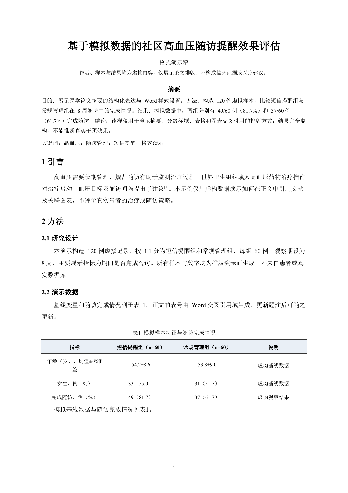

# 论文格式一键排版

以图表交叉引用和标题样式设置为核心的中文学术 Word 排版 Skill。它先对照目标期刊规范或作者提供的学位论文格式文件，为题名、分级标题、摘要、正文、图题和表题建立对应样式；再用 Word 题注与可更新交叉引用字段管理图表编号和正文指代，交付前逐项核对格式要求。

> `examples/医学论文格式演示.docx` 是排版能力展示用样稿。研究对象、样本和数值均为虚构，不是临床研究证据，不可用于医疗决策或学术引用。

## 核心能力：图表交叉引用与标题格式

- **图表交叉引用：**建立 Word 图/表题注，使用可更新的编号域和正文交叉引用域；增删或移动图表后可更新编号，并检查跳转目标。
- **标题与正文样式：**按目标要求为题名、分级标题、摘要、关键词、正文、图题、表题和表格内容建立或修改 Word 样式，保留标题层级与目录导航。
- **期刊/学位论文格式对照：**国内期刊稿优先核对官网指南和模板；学位论文依据作者提供的学校规范、模板或参考论文。
- **可选样文统计：**统计同刊同类型样文的摘要和引用、图表表达、结论组织等；无论是否统计，正式格式要求都逐项核对。
- **透明交付：**列出新建/修改的样式、已完成的格式检查，以及未满足、待核实或需作者补充的要求。

## 安装

将 `paper-format-one-click` 文件夹复制到 Codex Skills 目录：

- Windows：`%CODEX_HOME%\skills\paper-format-one-click`，未设置 `CODEX_HOME` 时通常为 `%USERPROFILE%\.codex\skills\paper-format-one-click`
- macOS/Linux：`$CODEX_HOME/skills/paper-format-one-click`，未设置时通常为 `~/.codex/skills/paper-format-one-click`

重新加载或重启 Codex 后，可以显式调用 `$paper-format-one-click`。也可在 Codex 中使用 Skill 安装流程从 GitHub 仓库安装。

## 示例请求

```text
请按《目标期刊》的官方格式要求排版这份中文论文。先检查期刊指南；可选地统计近期同类型论文。对不符合要求或缺少的信息列出清单，不要猜填。交付时说明新建和修改了哪些 Word 样式。
```

## 排版预览



## 示例文件

- `examples/医学论文格式演示.docx`：模拟中文医学论文，展示题名、摘要、分级标题、上标引文、图题/表题、跨页友好表格、图表正文交叉引用及参考文献样式。
- `examples/演示内容说明.md`：说明演示数据的虚构范围和文件内的格式样式。

## 使用边界

- 期刊或学校明确规定的格式要求优先于通用默认格式和样文习惯。
- 学位论文格式模仿需要作者提供学校规范、模板或参考文件；资料不足时先索取，不推测未提供的具体格式。
- 只依据作者提供或可核验的真实研究材料写作和填充数据；不编造医学数据、作者信息或研究结论。
- 格式辅助不替代医学专业审查、伦理审查、统计复核或期刊编辑决定。

## 许可

尚未指定开源许可证。公开仓库前请作者选择并添加适用的 `LICENSE` 文件。
